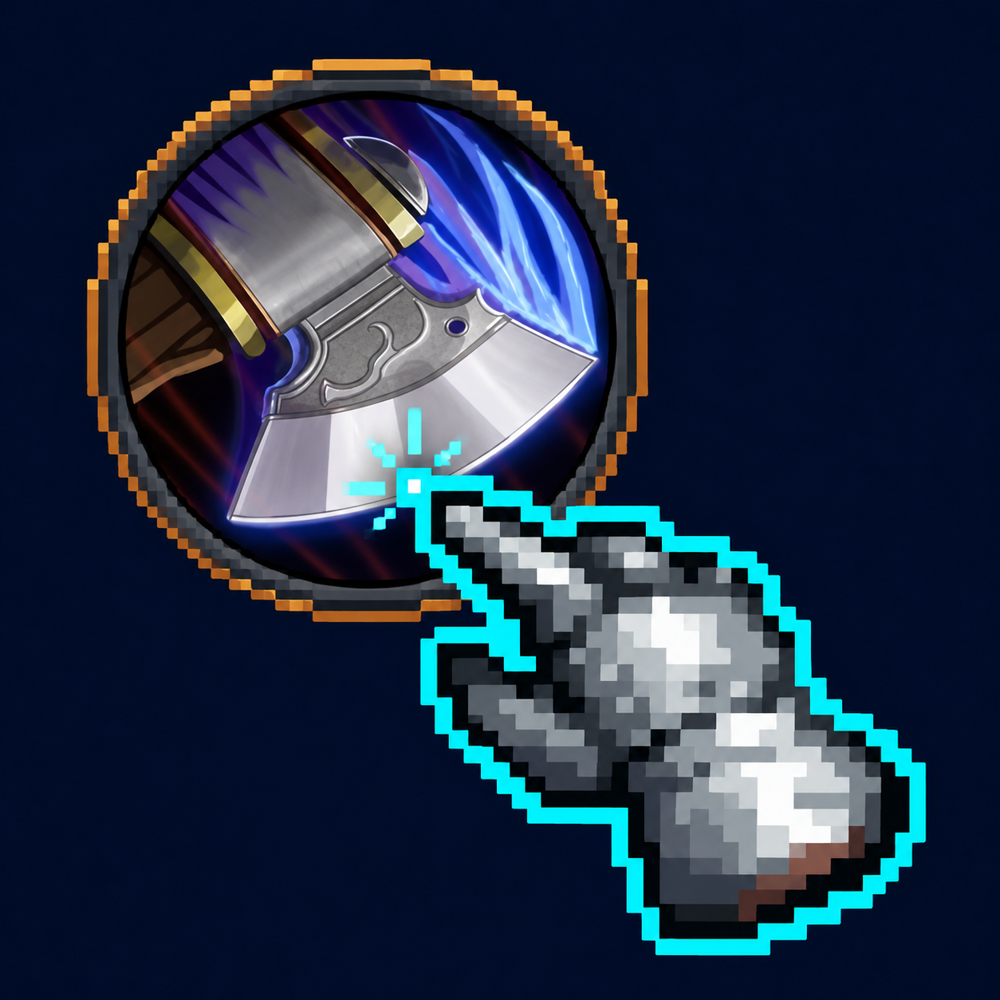

# Touchbars

**Customizable touchscreen action bars for World of Warcraft.**

Touchbars puts your spells and everyday controls within easy reach, with circular action buttons,
a flexible utility bar, and a movable layout editor. Designed around real iPad play with
Slashplayed Enhanced, it also works as a standalone addon.

## Features

- **Arrange your own layout:** move and resize individual spell buttons.
- **Keep essentials close:** group items, consumables, mounts, and macros in a configurable utility bar.
- **More abilities within reach:** two spell sets, plus separate Ctrl, Alt, and Shift layers.
- **Independent controls:** move, resize, or hide Target, Map, and contextual Interact buttons.
- **Make it yours:** separate colour, opacity, glow, spacing, and visibility settings.
- **Edit with confidence:** selection highlights, an inert preview, and session Undo.
- **Keep your setup:** assignments and layouts save per character, separately from native action slots.

## Getting started

1. Install the `SPTouchBars` folder in your game's `Interface/AddOns/` directory.
2. Enable **SPTouchBars** in the AddOns list.
3. Type `/sptouch`, or open **Settings → AddOns → SPTouchBars → Edit layout**.
4. Drag spells from the spellbook, items from your bags, mounts, or existing macros onto the buttons.
5. Arrange your layout and press **Done** to play.

Buttons start empty. Normal player bars are hidden by default; **More... → Default bars** restores
them. Pet, stance, vehicle, and special-action controls retain their native behavior.

## Compatibility

- **Forever:** touch action bars, native gamepad Interact delegation, and contextual quest steps.
- **Retail — experimental:** action bars, utility controls, targeting, layout editing, and open-quest
  steps. Use WoW's **Interact With Target** key/controller binding or a normal world click to talk or loot.
  Live Retail gameplay validation is still pending.

Every quest step requires another press. Multiple reward choices always wait for your manual selection.
Layout editing is unavailable in combat; preconfigured secure action buttons remain usable.

The installed folder and settings name remain **SPTouchBars** to preserve existing layouts.
Touchbars does not include a touchscreen driver or the native Slashplayed joystick and keyboard overlays.

[Source code and issues](https://github.com/rollarz/Touchbars) ·
[Slashplayed Enhanced](https://github.com/rollarz/slashplayed-enhanced)
