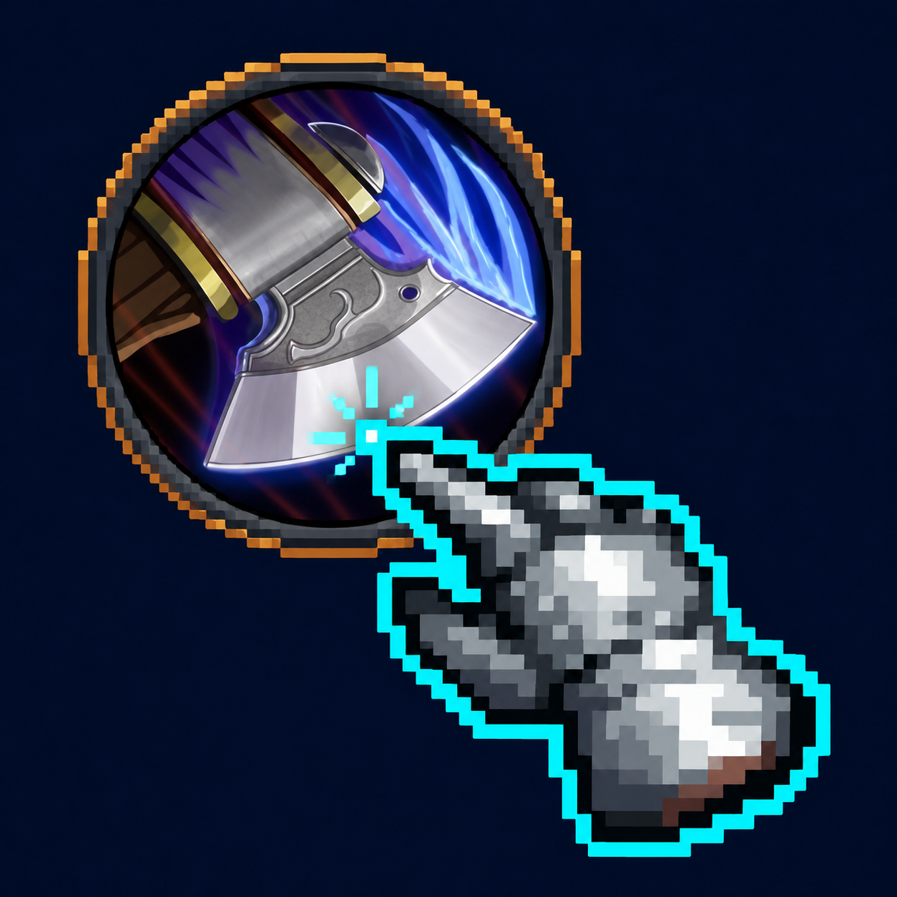

# Touchbars

<p align="center"></p>

Touchbars is an experimental touchscreen action-bar addon for World of Warcraft: Forever
(interface `16001`) and Retail (interface `120105`). Its standalone repository is
[rollarz/Touchbars](https://github.com/rollarz/Touchbars). The installed folder and settings name
remain `SPTouchBars` so existing character layouts survive upgrades.
Starts with six circular spell buttons on the right and eight square utility buttons at the bottom.
Spell circles have individual positions and sizes. Utility icons share a movable grid, size, and row count.
Separate Interact, Target, and Map circles can be moved, resized, or turned off. All settings and assignments
are saved per character.
These bars start empty and do not use WoW's native action slots. Empty slots are hidden during play
and reappear in Edit layout so you can assign them. Existing layouts keep their positions
when upgrading from the old version, but spells and utility must be assigned again.

## Install

Slashplayed bundles this addon and installs it automatically before launching Forever or Retail, including
games installed directly on the device. A new Slashplayed build updates the bundled addon files on
the next launch without overwriting your saved layout. Open **WoW Settings > AddOns > SPTouchBars > Edit layout**,
or enter `/sptouch`, to configure it.
You can disable it in WoW's AddOns list.

For a normal Battle.net install, or to try the standalone addon:

1. Close WoW. Copy the entire `SPTouchBars` folder into your game's `Interface/AddOns/`.
   `SPTouchBars.toc` must be directly inside `Interface/AddOns/SPTouchBars/`.
2. In Slashplayed, use the game's **Open in Files** setting to find its folder.
   On a normal Battle.net installation, use `_forever_/Interface/AddOns/` or `_retail_/Interface/AddOns/`.
3. Start WoW and enable **SPTouchBars** in the character screen's AddOns list.

Normal player action bars are hidden by default. In the editor's **More...** page, **Default bars: hidden / shown**
restores them whenever needed. Their original assignments, positions, and keybindings stay intact.
Pet, stance, vehicle, possession, override, and extra-action controls remain available. Disabling the
addon and reloading restores WoW's normal bars.

## Arrange and assign

- Open **WoW Settings > AddOns > SPTouchBars > Edit layout**, or enter `/sptouch`. The compact
  inspector uses WoW's native frames, font strings, and sliders. Tap a spell, utility icon, or touch
  control to inspect it; the **Spells**, **Utility**, and **Controls** tabs also select a group.
  Drag the panel itself to move it out of the way. It scales to fit smaller displays.
- The selected control turns teal. **Button size** or **Selected control size** adjusts just that
  button, from 44 to 140 UI units, using a slider or the adjacent minus/plus buttons. With no
  selection, the panel says **Select a button to resize**. Spell count
  runs from 1 to 12. Size depends on WoW's UI scale.
- Selecting a utility icon highlights the whole grid. **Utility buttons**, **Rows**, **Icon size**,
  and **Spacing** configure the grid; dragging any utility icon moves the group. Utility count can
  be 0 to 12. Spacing adjusts both axes from 0 to 48 UI units. Shrinking the count keeps assignments.
  Crowded grids reduce displayed spacing to fit useful touch targets on screen.
- **Layer: Set 1** cycles through Set 1, Shift, Alt, Ctrl, and Set 2 for assignment without holding
  keyboard keys. Utility assignments stay on their own shared layer.
- **Border & glow** opens the current group's colour picker, outline-opacity slider, and glow
  slider inside the same compact panel. **Visibility** opens the group's bar/empty-slot switches.
  **Back to layout** returns to sizing and positioning. Spell/touch-control and utility styles stay
  independent. Controls can be selected by name and turned on/off from their tab.
- **Preview** hides empty/disabled slots according to the saved visibility settings and removes
  editing numbers/highlights. **Edit** restores the assignment view. Preview remains inert: it does
  not cast or interact, so tap **Done** when ready to play.
- Drag a spell from the spellbook, an item from your bags, a mount from the journal, or an existing
  macro from the macro window onto an icon while editing. You can also tap an icon while carrying
  one on the cursor. This selects the icon and changes only its private assignment. WoW itself
  removes an original action when picked up from a native bar; use the spellbook for a copy.
- **More...** contains the individual Ctrl/Alt/Shift switches, native-bar visibility, **Center utility
  bar**, **Clear selected slot**, and **Reset positions**. Clearing affects only the selected spell
  or utility slot in the displayed layer, even when the whole utility grid is highlighted.
  Reset positions keeps assignments, counts, appearance, and control enable/disable choices.
- **Undo** restores the settings and assignments from the start of this editing session. **Done**
  keeps changes; reopening starts a fresh Undo baseline. Entering combat automatically closes the
  inspector and restores secure casting, including when Preview was active.

There is no permanent Edit button on the HUD. Action and interaction buttons remain inert while
editing. During play, buttons show their normal rims and halos, with gold press feedback. Target
and Interact retain their full circular faces and labels.

Positions use fractions of the screen and are clamped when the display changes. Rotation preserves
relative positions; a crowded layout may need adjusting after a large aspect-ratio change.

## Spell layers and sets

| Control | Behavior |
| --- | --- |
| Set 1 | Default private spell set |
| Shift | Alternate assignments while Shift is held |
| Alt | Alternate assignments while Alt is held |
| Ctrl | Alternate assignments while Ctrl is held |
| Set 2 | Second private spell set |
| Utility | Fixed, independent consumables, buffs, mounts, and other utility |

Tap the **circular arrows** button to switch the main set, including during combat. Its small label
shows **1 / 2**, or **S / A / C** for a held modifier. Move or resize the switch while editing. With a modifier held, the
modifier layer remains visible; releasing it returns to the newly selected set. Modifier priority is
Ctrl, Alt, and then Shift among enabled layers. **Ctrl: on/off**, **Alt: on/off**, and **Shift: on/off**
are separate controls in Settings and the editor. Disabling one leaves the others active and preserves
all its assignments. If Ctrl is off while Alt is on, holding both shows the Alt layer. **Preview** can
still display and edit a disabled layer. The modifier layers are shared between both main sets. The addon does not
automatically follow Blizzard's stance, stealth, or main-bar paging.

WoW's existing keyboard bindings still operate Blizzard's bars. This addon does not rebind them.
Hardware modifiers, or Slashplayed's on-screen Ctrl, Alt, and Shift keys, switch the touch layers.
Spell, item, and macro assignments belong only to SPTouchBars. The numbered labels in the editor
identify buttons within the displayed layer. Native action slots are never written by the addon.

For modifier macros, turn off only the layers whose modifier keys the macro needs. For example,
leave **Shift: on**, with **Ctrl: off** and **Alt: off**, to page with Shift while Ctrl/Alt reach macros
on the displayed set. To use all three keys in a single macro without paging, turn all three layers off.
Create a normal macro and drag it onto a button:

```text
#showtooltip
/cast [mod:ctrl] Pummel; [mod:alt] Charge; [mod:shift] Rend; Mortal Strike
```

Replace the example with spells your character knows. WoW supplies the macro's icon and tooltip.
The utility bar always keeps the same assignments, but macros placed there still receive modifiers.
Macros are saved by name; keep the macro present, and reassign it if you rename or delete it.
Ordinary game targeting applies; ground-targeted spells still require their normal placement tap
unless the macro explicitly uses a targeting conditional.

## Interact and Target controls

These are pre-made controls outside the spell sets and utility slots. Both start enabled. Toggle
**Interact: on / off** and **Target: on / off** in Settings, or use their **On / Off** switches in
the editor's **Controls** tab. Drag and resize each while
editing; their positions and visibility are independent of spell count, set, and modifier layers.

- **Interact on Forever** runs a secure macro that clicks the native gamepad Interact control with a complete
  press/release pair. It follows Blizzard's choice of talking, looting, gathering, or attacking, and copies
  the native icon. **Nearby interaction** is on by default in addon Settings: it temporarily enables
  WoW's interaction detection for mouse/touch input as well as gamepads. The previous version left
  detection in its gamepad-only default, so Interact worked only after manually selecting a target.
  Turning nearby interaction or Interact off releases the temporary override; saved game preferences
  remain intact. Face a nearby NPC or corpse, or select it first. Normal interact range and loot rules
  apply; auto-loot follows the game setting. Quest windows use the contextual steps described below.
  The native control can attack a selected enemy as well. If its UI is unavailable, the circle says
  **Unavailable** and stays inert until the native control is loaded.
- **Interact on Retail** advances an already open quest window, one step per press. Outside a quest
  window it reads **Interact key**: use WoW's **Interact With Target** key/controller binding or the
  normal world click to talk or loot. Retail has no Forever gamepad Interact control, and its protected
  interaction API cannot be invoked by addon Lua. Nearby-interaction preferences are left alone.
- **Target** runs `/targetenemy [mod:shift] 1; 0`: acquire an enemy, then tap repeatedly to cycle eligible
  targets. Shift reverses the cycle. It does not begin attacking or change targets on its own.

### Quest steps

**Quest steps: on/off** in addon Settings is enabled by default. With a quest NPC/window open, each
press of Interact performs one step, and its label tells you what is next:

- **Quest** opens the first eligible quest in the displayed list. Subsequent presses process offers
  and completed turn-ins from top to bottom. Incomplete quests are skipped. Both the gossip list and
  the classic quest greeting are supported, including their different display orders.
- **Accept** clicks the native Accept button for the visible offer, including the offer shown in the
  screenshot. Opening the NPC never accepts the newly opened offer on that same press.
- **Continue** opens the reward page for a completable quest. A further press on **Turn in** completes it.
- **Reward** waits for you to click a reward when multiple items are offered. Once selected, Interact
  changes to **Turn in**; another press completes the quest using that selection. It never chooses a
  reward for you. A quest with one fixed choice uses the native completion behavior.
- **Wait**, **Not ready**, **Confirm**, or **Choose** leave disabled buttons, incomplete quests, native
  confirmation dialogs, and other dialogue choices to their normal UI controls.

Only successful acceptance/turn-in events mark a quest handled for that NPC, so immediately reoffered
repeatables or stale lists do not trap the sequence. Different NPCs start a fresh sequence. Quest steps
are disabled while editing and in combat. Events do not select or accept quests automatically.

### Visibility and appearance

In **WoW Settings > AddOns > SPTouchBars**, open **Spell buttons** or **Utility bar** in the sidebar.
Each has independent settings:

- **Bar: on/off** hides or shows that entire group without deleting assignments.
- **Hide empty: on/off** hides unassigned slots, enabled by default. Spell visibility follows the
  current set or modifier layer, including switches during combat. An entirely empty bar disappears.
- **Outline colour** opens WoW's native colour picker with live colour and opacity preview.
  **Cancel** restores both previous values.
- **Outline opacity** controls rims and bevels from 0% to 100%. **Glow intensity** independently
  controls the halo, including switching it off. Spell and item icons stay visible at 0%.
- **Reset appearance** resets only the current group's colour, opacity, and glow.

Spell appearance also applies to Interact, Target, and Map. Utility appearance affects just the bottom
grid. Existing global colours and opacity migrate into both groups; you can then change them separately.
Selection and press colours still give temporary feedback. All settings are saved per character.

Edit layout always reveals the configured spell and utility slots, even when the group is disabled.
Empty slots keep their positions rather than shifting other buttons when a layer changes.
Shrinking the configured count still removes the excess slots from the editor.

### Map and set arrows

**Map: on/off** on the main addon settings page controls a separate world-map button. It starts just
outside the minimap, opens/closes WoW's world map, and can be dragged and resized in Edit layout like
Interact and Target. Editing selects the button without opening the map.

The set switch uses smooth, rounded arrows drawn from an original SVG, inside a hollow circular border with a light 12% tint
and a larger centered set/modifier label. The icon scales with the button size and tints on selection or press.
The addon ships the antialiased `SPTouchBars.tga`; `art/cycle.svg` is the editable source and
`python3 art/build_cycle.py` regenerates both from shared geometry (requires Pillow). **Set arrows: on/off** can hide this control separately.
Turn a disabled standalone control back on in Settings before editing it.

`/sptouch status` reports the current nearby interaction mode (3 means all input types) and whether
the native Interact button is available.

The interaction approach was checked against [ConsolePort's native-binding interaction handler](https://github.com/seblindfors/ConsolePort/blob/master/ConsolePort/Controller/Interact.lua),
[the Forever gamepad extension](https://github.com/LyraelRayne/ConsolePort_GamepadSlots/blob/master/Interact.lua),
and [Forever's own Interact handling](https://github.com/Gethe/wow-ui-source/blob/forever/Interface/AddOns/Blizzard_GamepadActionBars/MainActionBarFrame.lua).
The addon does not depend on ConsolePort or copy its implementation. Its macro payloads use
[Forever's secure macro handler](https://github.com/Gethe/wow-ui-source/blob/forever/Interface/AddOns/Blizzard_FrameXML/SecureTemplates.lua)
and [native click command](https://github.com/Gethe/wow-ui-source/blob/forever/Interface/AddOns/Blizzard_ChatFrameBase/Shared/SlashCommands.lua).
Nearby detection uses the same [input flags as WoW's Enable Interact Key option](https://github.com/Gethe/wow-ui-source/blob/forever/Interface/AddOns/Blizzard_SettingsDefinitions_Frame/Controls.lua)
through a temporary CVar, rather than changing the player's saved preference.

## Validation and limits

The Lua 5.1 behavioral harness checks the compact selection inspector, native sliders, session Undo,
safe play preview, combat interruption, smaller displays, settings entry, selection tint, utility group dragging, row and
size controls, independent control toggles, private assignments, spellbook cursor IDs, items, mounts,
named macros, native-bar hiding/restoration, preserved pet/special controls, modifier priority, assignment
previews, individual modifier toggles and old-profile migration, secure set switching, combat-safe
press feedback and cancellation, utility spacing on both axes, crowded layouts, secret cooldown handling, display changes, and
quest offers and turn-ins in both list orders, manual reward gating, disabled/confirmation buttons,
colour-picker preview/cancel, independent spell/utility colour, opacity and glow, secure empty-slot
visibility across layers and sets, whole-bar hiding and editor recovery, movable world-map controls,
transparent set arrows, legacy appearance migration, and saved profile validation. A gamepad-only input fixture reproduces the reported proximity failure and
checks unselected NPC/corpse interactions, temporary setting cleanup, existing preferences, and
native target-change overrides. Native slot mutation functions throw in the harness. Run from this repository:

```sh
lua5.1 test/sptouchbars.lua SPTouchBars/SPTouchBars.lua
lua5.1 test/sptouchbars.lua SPTouchBars/SPTouchBars.lua retail
python3 scripts/package.py
```

The same harness also runs a Retail fixture without Forever's gamepad addon. It checks startup,
saved spells/items, secure casting and targeting, duration-object/secret cooldowns, quest acceptance,
manual reward selection, combat interruption, and reload persistence. Retail support is tested against
mock APIs and reviewed against the current UI source; live Retail gameplay validation is still pending.

Version 0.6.0's native editor was checked in the Mac client. Broader gameplay checks on the Mac and
iPad remain: talk to an NPC, loot a corpse,
cycle enemies, cast normal and macro spells, switch sets/modifiers in combat, begin an encounter during
a drag, relog, and use a vehicle/override UI. The harness cannot prove client permission or range behavior.
Secret cooldown numbers are never calculated in Lua: duration objects drive widgets when available,
and concealed timings without a duration API clear the swipe. Hover tooltips are off by default.
There is no automatic combat, background quest processing, dialogue-option selection, or camera/movement control.

API references: [Forever's captured API findings](https://github.com/Thunderz96/forever-addon-kit)
and [the WoW UI source mirror](https://github.com/Gethe/wow-ui-source).
Quest actions delegate to [native quest controls](https://github.com/Gethe/wow-ui-source/blob/forever/Interface/AddOns/Blizzard_UIPanels_Game/Mainline/QuestFrame.lua)
and [native gossip selection](https://github.com/Gethe/wow-ui-source/blob/forever/Interface/AddOns/Blizzard_UIPanels_Game/Shared/GossipFrameShared.lua).
Appearance uses [WoW's colour-picker API](https://github.com/Gethe/wow-ui-source/blob/forever/Interface/AddOns/Blizzard_ColorPickerFrame/Mainline/ColorPickerFrame.lua).

The Map button delegates to [Forever's native world-map toggle](https://github.com/Gethe/wow-ui-source/blob/forever/Interface/AddOns/Blizzard_WorldMap/Blizzard_WorldMap.lua).

## Download and package

Download this repository as a ZIP using **Code > Download ZIP**, then copy its `SPTouchBars` folder
into your game’s `Interface/AddOns/` folder. You can also run `python3 scripts/package.py` to create
`dist/Touchbars-0.7.0.zip`; extract that ZIP directly into `Interface/AddOns/`.

## Credits and license

Built for [Slashplayed Enhanced](https://github.com/rollarz/slashplayed-enhanced), based on
[Slashplayed by Paul Straw / Straw Dynamics](https://github.com/paulstraw/slashplayed).
The addon is MIT licensed; see [LICENSE](LICENSE). The project logo was composed with OpenAI image generation using user-supplied cursor and spell references. World of Warcraft and its artwork belong to Blizzard Entertainment.
